# ⚡ Dev Toolkit

Локальный набор утилит для ежедневной работы программиста. Работает **полностью офлайн**: ваши JSON, токены и пароли никуда не уходят.

Есть веб-интерфейс (светлая и тёмная тема, поиск по `Ctrl+K`) и CLI для терминала.

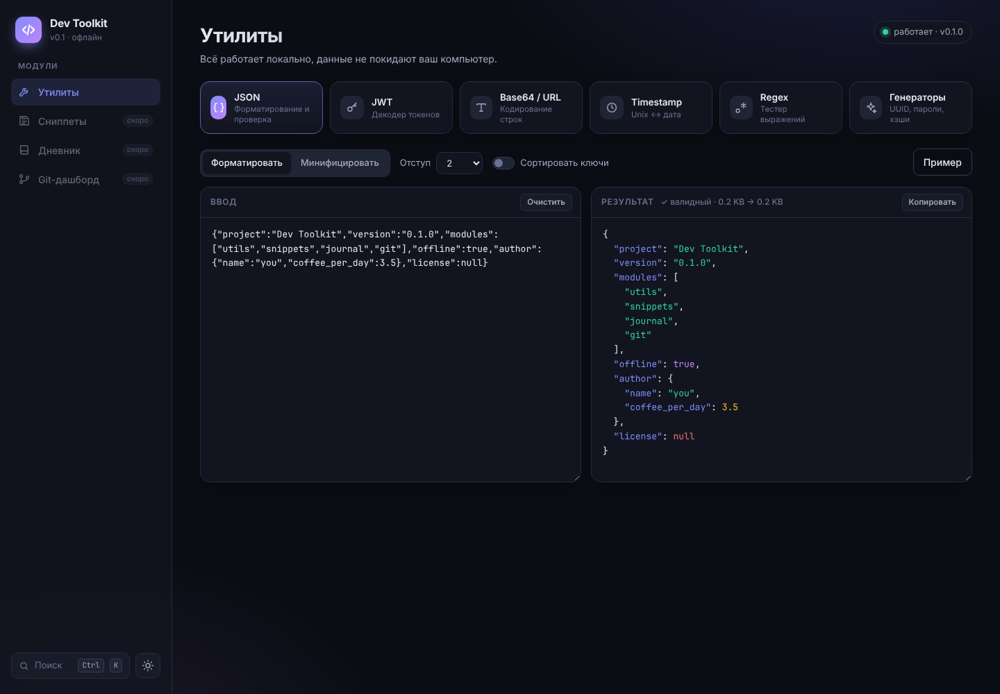

## Возможности

| Инструмент | Что умеет |
|---|---|
| **JSON** | форматирование, минификация, сортировка ключей, подсветка, ошибки с номером строки |
| **JWT** | раскодирует header и payload, показывает статус (действителен / истёк) и даты `iat`/`nbf`/`exp` |
| **Base64 / URL** | кодирование и декодирование, URL-safe Base64, кнопка «поменять местами» |
| **Timestamp** | Unix (с / мс / мкс) ↔ ISO-дата, любой часовой пояс, «2 часа назад» |
| **Regex** | живая подсветка совпадений, группы и именованные группы, флаги `i m s x` |
| **Генераторы** | надёжные пароли с оценкой энтропии, UUID v4, хэши MD5/SHA1/SHA256/SHA512 |

### 📋 Сниппеты

Храните команды и куски кода, которые постоянно гуглите, и находите их за секунду.

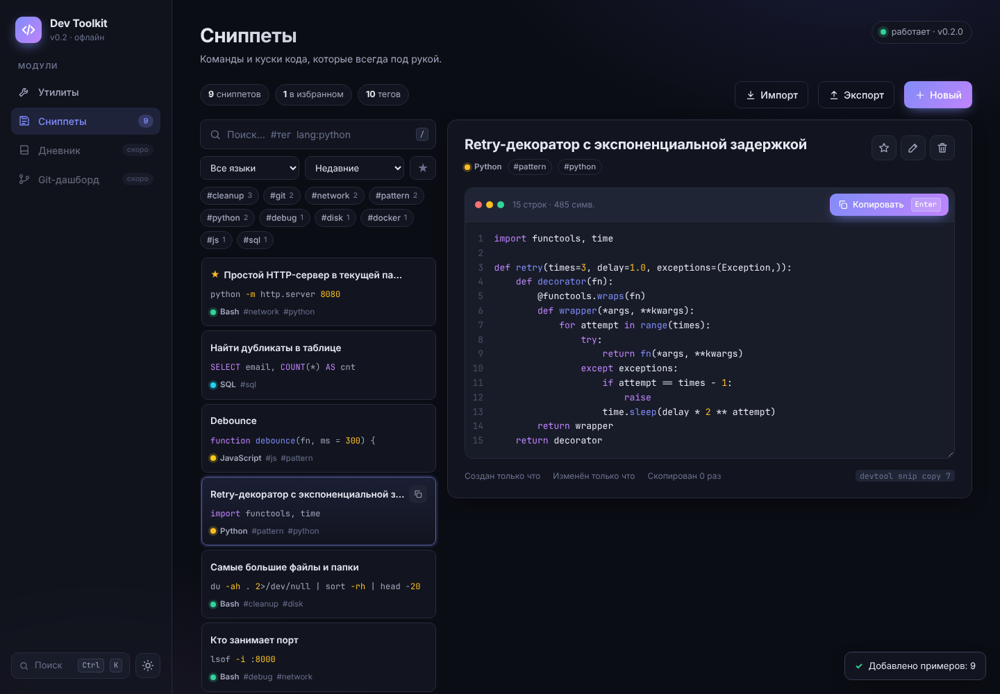

- поиск по всем полям; `#тег` фильтрует по тегу, `lang:python` по языку;
- теги, избранное, сортировка по недавним, популярным или алфавиту;
- подсветка синтаксиса для 18 языков, номера строк;
- счётчик использований: часто копируемые сниппеты поднимаются выше;
- **`Ctrl+K` из любого места** ищет и сразу копирует сниппет;
- импорт и экспорт в JSON, набор полезных примеров для старта;
- данные хранятся в SQLite: `~/.devtool/devtool.sqlite3`, путь меняется через переменную `DEVTOOL_DB`.

Горячие клавиши в модуле: `/` поиск · `↑↓` или `j`/`k` навигация · `Enter` копировать · `N` новый · `E` редактировать · `F` избранное · `Ctrl+Enter` сохранить · `Esc` отмена.

### 📝 Дневник разработчика

Короткие записи о работе и отчёт к стендапу в один клик.

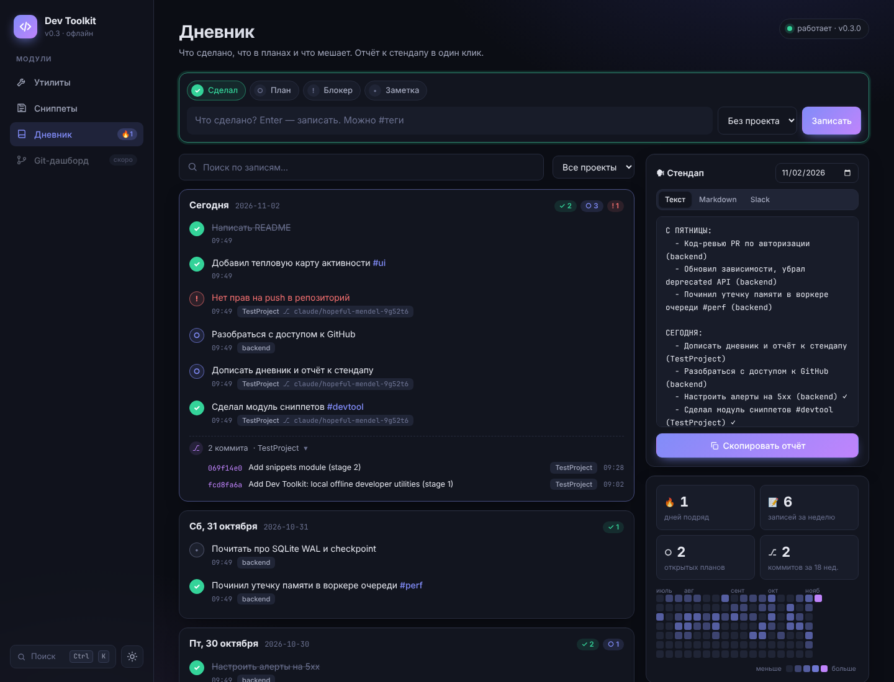

- четыре типа записей: **Сделал**, **План**, **Блокер**, **Заметка**; планы и блокеры отмечаются выполненными одним кликом;
- проект и ветка git определяются автоматически по папке, из которой вызван `devtool log`;
- **отчёт к стендапу** «вчера / сегодня / блокеры» в форматах Текст, Markdown и Slack. В понедельник «вчера» — это пятница и выходные;
- ваши **коммиты** из всех репозиториев в указанных папках сами попадают в таймлайн и отчёт (только ваши, по `user.email`);
- таймлайн по дням, поиск, фильтр по проекту, `#теги`;
- тепловая карта активности за 18 недель, серия дней подряд 🔥.

Горячие клавиши: `Enter` записать · `Alt+1…4` сменить тип записи. Через `Ctrl+K` можно скопировать отчёт к стендапу из любого места.

### 🌿 Git-дашборд

Все ваши репозитории на одном экране.

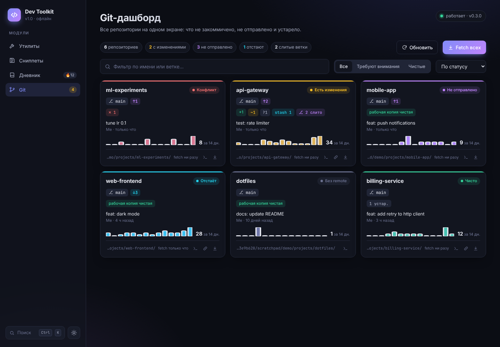

- статус каждого репозитория: **изменения** (staged / modified / untracked / конфликты), **↑ не отправлено**, **↓ отстаёт**, stash;
- последний коммит, активность за 14 дней, время последнего fetch;
- сначала показаны репозитории, которым нужно внимание; есть фильтры и поиск;
- по клику открывается панель: список изменённых файлов, ветки (слитые, устаревшие, с удалённым upstream), последние коммиты;
- безопасные действия: **Fetch** (одного или всех сразу), **Pull --ff-only** (только если рабочая копия чистая), **удаление слитых веток** через `git branch -d`, копирование `cd`, ссылка на GitHub / GitLab / Bitbucket;
- команды выполняются только в репозиториях из ваших папок с проектами; токены в URL remote скрываются.

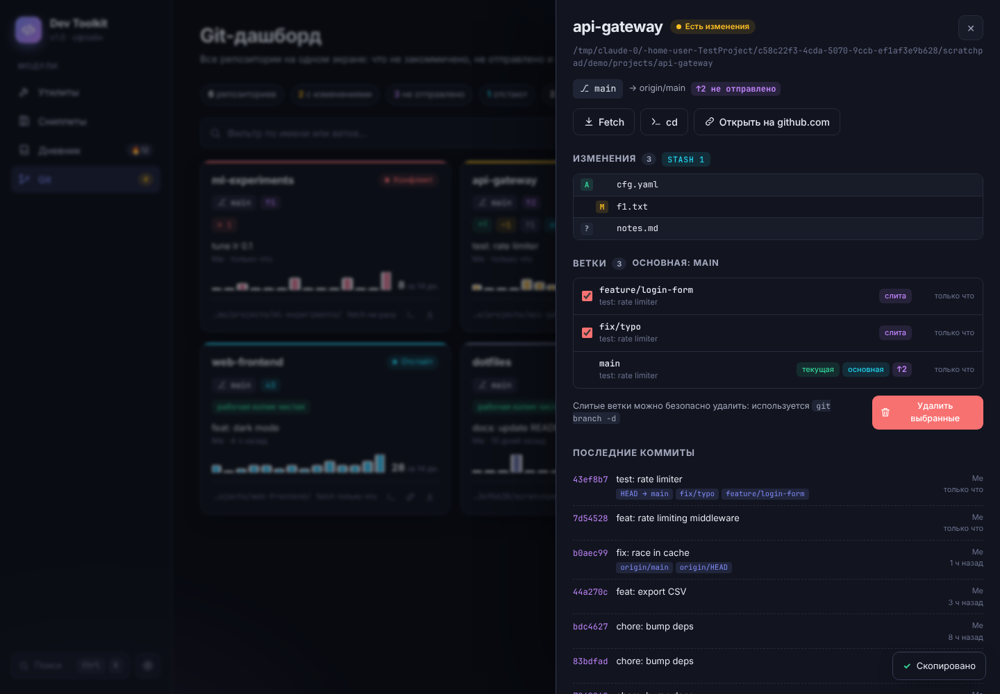

<details>
<summary>Ещё скриншоты</summary>

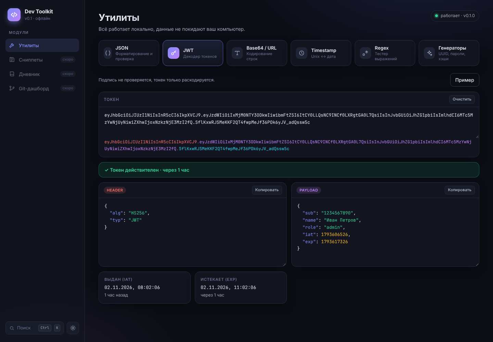
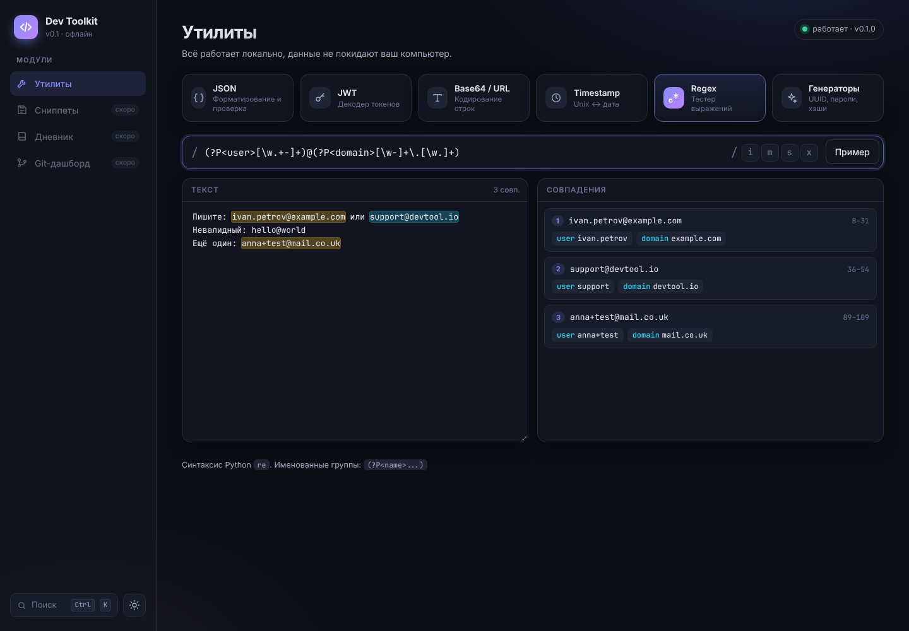
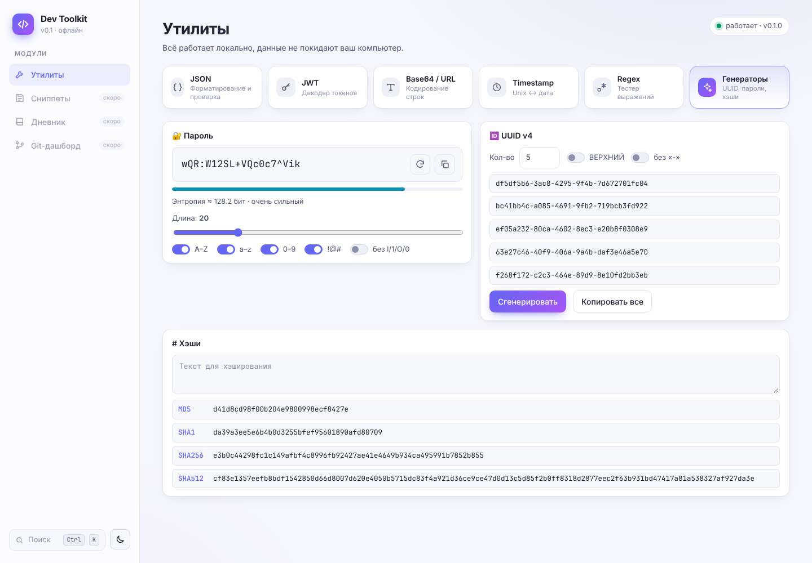
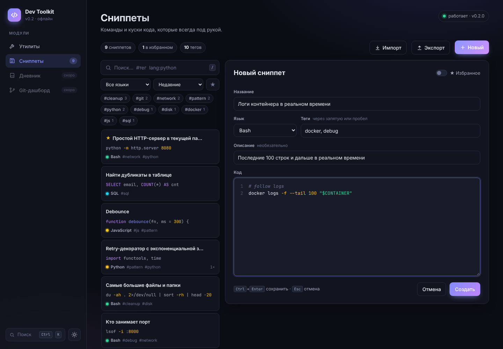
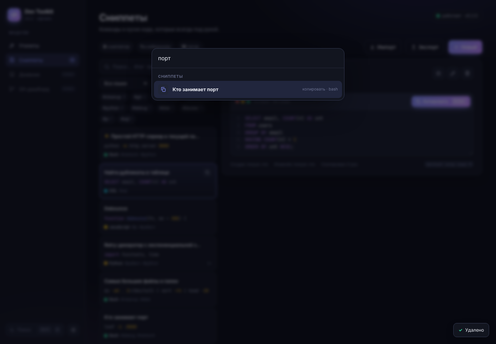
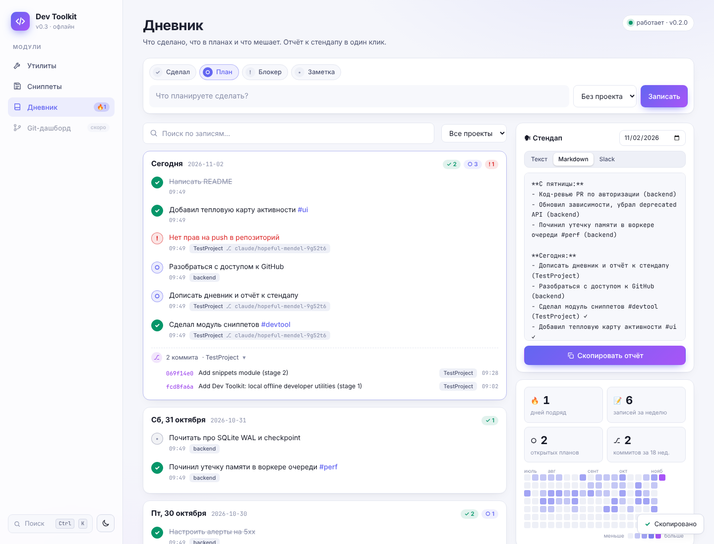
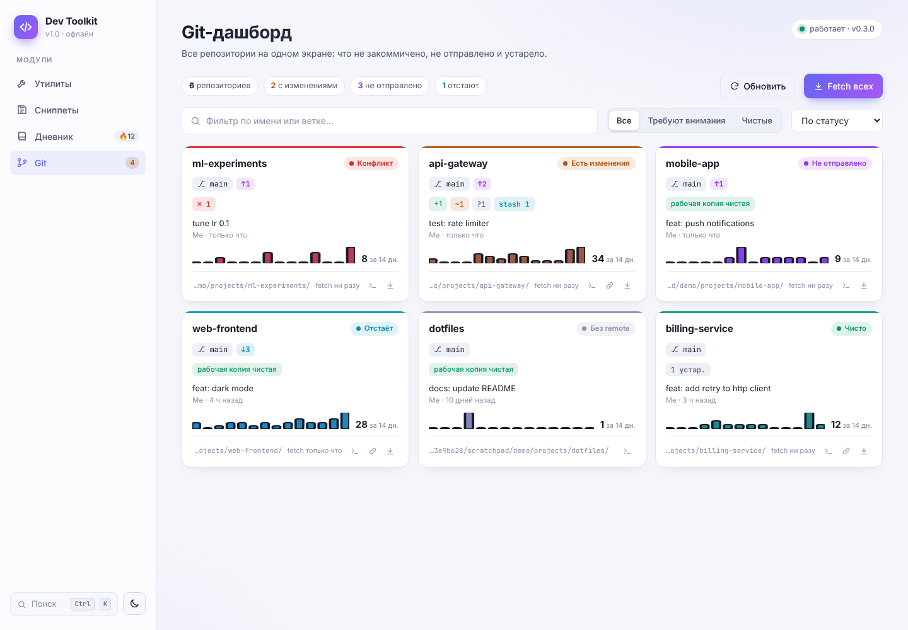

</details>

## Скачать программу

Готовые установщики лежат на странице **[Releases](https://github.com/Auco24/TestProject/releases/latest)**. Python ставить не нужно, он уже внутри.

| Система | Файл | Как установить |
|---|---|---|
| **Windows 10 / 11** | `DevToolkit-Setup-<версия>.exe` | Запустите установщик. Права администратора не нужны. Программа появится в меню «Пуск» и, если отметить, на рабочем столе. Удаление: «Параметры» → «Приложения». |
| **macOS 11+** | `DevToolkit-<версия>-macOS.dmg` | Откройте `.dmg` и перетащите **Dev Toolkit** в «Программы». При первом запуске: правый клик → «Открыть» (приложение пока не подписано сертификатом Apple). |

Программа открывается в собственном окне и работает полностью офлайн. Ваши данные (сниппеты, дневник, настройки) хранятся в папке `~/.devtool` (`C:\Users\<имя>\.devtool` на Windows) и сохраняются при удалении и обновлении программы.

Для дневника (коммиты) и Git-дашборда нужен установленный [Git](https://git-scm.com/downloads); остальное работает и без него.

> **Windows SmartScreen** может показать «Windows защитила ваш компьютер», потому что установщик не подписан платным сертификатом. Нажмите «Подробнее» → «Выполнить в любом случае».

## Установка из исходников (для разработчиков)

Нужен Python 3.10+. Так же устанавливается командная строка `devtool`.

```bash
git clone https://github.com/Auco24/TestProject.git
cd TestProject
python -m venv .venv
source .venv/bin/activate        # Windows: .venv\Scripts\activate
pip install -e .
```

## Запуск

```bash
devtool start
```

Браузер откроется на <http://127.0.0.1:8000>. Опции: `--port 9000`, `--no-browser`.

Открыть в отдельном окне, как установленную программу:

```bash
pip install -e ".[desktop]"
devtool app
```

## CLI

```bash
devtool json '{"a":1,"b":[1,2]}'          # форматировать
cat data.json | devtool json --minify      # минифицировать из stdin
devtool jwt eyJhbGciOi...                  # раскодировать JWT
devtool b64 "Привет"                       # → 0J/RgNC40LLQtdGC
devtool b64 -d 0J/RgNC40LLQtdGC            # → Привет
devtool url "a b&c"                        # → a%20b%26c
devtool ts                                 # текущее время во всех форматах
devtool ts 1730505600 --tz Europe/Berlin   # timestamp → дата
devtool regex '\d+' "a1 b22 c333"          # проверить regex
devtool hash "hello" -a sha256             # хэш
devtool uuid -n 5                          # 5 UUID
devtool pass -l 32                         # пароль из 32 символов
```

### Сниппеты в терминале

```bash
devtool snip add "docker ps -a" -t "Все контейнеры" -g docker
cat script.sh | devtool snip add - -t "Деплой" -l bash -g deploy
devtool snip add                           # откроет $EDITOR
devtool snip find docker                   # поиск
devtool snip find "#git" --sort popular    # по тегу, популярные сверху
devtool snip show 3                        # показать
devtool snip copy 3                        # в буфер обмена
devtool snip edit 3                        # редактировать в $EDITOR
devtool snip fav 3 / rm 3 / tags
devtool snip export backup.json            # экспорт
devtool snip import backup.json            # импорт (дубликаты пропускаются)
```

### Дневник в терминале

```bash
devtool log починил баг с логином #auth     # «Сделал», проект и ветка определятся сами
devtool log -p написать тесты              # план
devtool log -b жду доступы от DevOps        # блокер
devtool log -n почитать про WAL            # заметка
devtool log -y настроил CI                 # запись на вчера
devtool standup                            # отчёт к стендапу
devtool standup -f slack --copy            # в формате Slack, сразу в буфер обмена
devtool journal show --days 7              # записи и коммиты за неделю
devtool journal done 12                    # отметить план выполненным
devtool journal roots --add ~/projects     # где искать git-репозитории
```

### Git-дашборд в терминале

```bash
devtool repos                              # статус всех репозиториев
devtool repos -a                           # только требующие внимания
devtool repos fetch                        # git fetch --all --prune везде
devtool repos branches my-app              # ветки: слитые, устаревшие, upstream удалён
devtool repos prune my-app                 # удалить слитые ветки (git branch -d)
```

`devtool --help` и `devtool <команда> --help` показывают все опции.

## Разработка

```bash
pip install -e ".[dev]"
pytest
```

### Сборка установщиков

Установщики собирает GitHub Actions (`.github/workflows/desktop.yml`) на каждом PR. Скачать их можно в разделе Artifacts у запуска. Чтобы опубликовать релиз, отправьте тег версии: `git tag v1.1.0 && git push origin v1.1.0`.

Собрать локально (на той же ОС, для которой нужна сборка):

```bash
pip install -e ".[build]"
pyinstaller packaging/devtool.spec --noconfirm   # dist/DevToolkit/ или dist/Dev Toolkit.app
dist/DevToolkit/DevToolkit --smoke-test          # проверка сборки без окна
```

Для Windows установщик затем собирается так: `ISCC.exe packaging\windows\installer.iss` ([Inno Setup 6](https://jrsoftware.org/isinfo.php)).

API-документация (Swagger) открывается на <http://127.0.0.1:8000/api/docs>, пока сервер запущен.

### Структура

```
devtool/
├── tools.py        # утилиты: чистые функции без зависимостей
├── db.py           # SQLite: подключение и миграции
├── snippets.py     # сниппеты: CRUD, поиск, теги, импорт/экспорт
├── journal.py      # дневник: записи, таймлайн, стендап, статистика
├── gitinfo.py      # обёртки над git CLI: репозиторий, ветка, коммиты
├── repos.py        # Git-дашборд: статус, ветки, fetch/pull/prune
├── settings.py     # настройки (key/value в SQLite)
├── clipboard.py    # буфер обмена без внешних зависимостей
├── api.py          # FastAPI: /api/tools/*, /api/snippets/*, /api/journal/*, /api/git/* + интерфейс
├── cli.py          # Typer CLI
├── desktop.py      # настольное приложение: сервер в фоне + окно pywebview
├── i18n.py         # переводы (русский — исходный язык, английский, немецкий)
└── static/         # интерфейс: HTML + CSS + JS, без внешних CDN
    ├── app.js      #   утилиты, навигация, Ctrl+K
    ├── snippets.js #   модуль сниппетов + подсветка синтаксиса
    ├── journal.js  #   дневник, стендап, тепловая карта
    └── git.js      #   Git-дашборд
packaging/          # PyInstaller spec, установщик Windows (Inno Setup)
tests/              # pytest: модули, API, CLI (с настоящими временными git-репозиториями)
```

Чтобы добавить новый инструмент:
1. Напишите функцию в `tools.py`.
2. Зарегистрируйте её в `HANDLERS` в `api.py`.
3. Добавьте `<section class="tool">` в `index.html` и обработчик в `app.js`.
